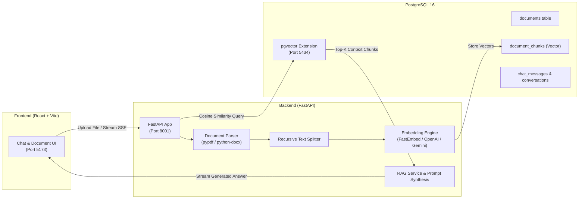

# 🧠 Nexus RAG: Production Document Intelligence Platform

A high-performance, containerized **Retrieval-Augmented Generation (RAG)** platform designed for document-grounded question answering with source citations. Built with **FastAPI**, **PostgreSQL (pgvector)**, **React**, and **Docker**.

---

## 🌟 Key Features

- **Multi-Format Document Ingestion**: Upload and parse **PDF**, **DOCX**, **TXT**, **Markdown**, and **CSV** documents.
- **pgvector Similarity Search**: Sub-second approximate nearest neighbor (ANN) retrieval using PostgreSQL's native vector extension (`<=>` cosine distance).
- **Accurate Source Citations**: Every AI response includes clickable citations displaying the original document filename, chunk index, page number, similarity match %, and verbatim text excerpt.
- **Real-Time Streaming Responses**: Real-time token streaming using Server-Sent Events (SSE).
- **Pluggable LLM Providers**:
  - **OpenAI** (`gpt-4o-mini`, `gpt-4o`)
  - **Google Gemini** (`gemini-1.5-flash`, `gemini-1.5-pro`)
  - **Ollama** (`llama3.2`, `mistral` - 100% offline & local)
- **Zero-Setup Embedding Engine**: Comes with built-in local CPU embeddings (`FastEmbed` / ONNX `BAAI/bge-small-en-v1.5`), requiring **zero API keys** to parse and embed files immediately out-of-the-box. Also supports OpenAI (`text-embedding-3-small`) and Gemini.
- **Document Chunk Inspector**: Inspect raw vector chunks, character lengths, and metadata stored in PostgreSQL.
- **Scoped Retrieval Filtering**: Ask questions across all uploaded documents or scope retrieval to specific selected files.
- **Dockerized Architecture**: One-click startup with Docker Compose.

---

## 🏗️ Architecture Overview



---

## 🚀 Quick Start with Docker

### Prerequisites
- [Docker](https://docs.docker.com/get-docker/) (v20+)
- [Docker Compose](https://docs.docker.com/compose/) (v2+)

### 1. Configure Environment (Optional)
The default configuration works out of the box with zero external keys for embeddings (uses FastEmbed). To configure LLM generation (OpenAI or Gemini), edit `.env`:

```bash
# Optional: Add your API key if you want OpenAI or Gemini generation
OPENAI_API_KEY=sk-...
# or
GEMINI_API_KEY=AIzaSy...
```

### 2. Launch the Platform
```bash
docker compose up --build
```

### 3. Open in Browser
- **Frontend UI**: [http://localhost:5173](http://localhost:5173)
- **Backend Swagger API Docs**: [http://localhost:8001/docs](http://localhost:8001/docs)
- **PostgreSQL Database**: `localhost:5434` (User: `postgres`, Pass: `postgres`, DB: `nexus_rag`)

---

## 🛠️ Local Development (Without Docker)

### 1. Database (PostgreSQL with pgvector)
Run pgvector container:
```bash
docker run -d --name pgvector-dev -p 5434:5432 -e POSTGRES_PASSWORD=postgres -e POSTGRES_DB=nexus_rag pgvector/pgvector:pg16
```

### 2. Backend Setup
```bash
cd backend
python3 -m venv venv
source venv/bin/activate
pip install -r requirements.txt

# Start FastAPI development server
uvicorn app.main:app --host 0.0.0.0 --port 8001 --reload
```

### 3. Frontend Setup
```bash
cd frontend
npm install
npm run dev
```
Open [http://localhost:5173](http://localhost:5173).

---

## 📡 REST API Reference

| Method | Endpoint | Description |
|---|---|---|
| `POST` | `/api/documents/upload` | Upload single or multi-part documents (PDF, DOCX, TXT, MD, CSV) |
| `GET` | `/api/documents` | List uploaded documents with status and chunk count |
| `GET` | `/api/documents/{id}` | Get document metadata and all generated vector chunks |
| `DELETE` | `/api/documents/{id}` | Delete document and cascade delete its chunks from pgvector |
| `POST` | `/api/chat/stream` | Server-Sent Events (SSE) streaming RAG Q&A endpoint |
| `POST` | `/api/chat` | Standard non-streaming RAG Q&A endpoint |
| `POST` | `/api/evaluation/run` | Evaluate retrieval and generated answers against a golden question set |
| `GET` | `/api/chat/conversations` | List saved chat sessions |
| `GET` | `/api/health` | Health check verifying DB & pgvector extension status |

---

## ⚙️ Configuration Parameters (`.env`)

| Variable | Default | Description |
|---|---|---|
| `FRONTEND_PORT` | `5173` | Host port for the React UI |
| `BACKEND_PORT` | `8001` | Host port for the FastAPI backend |
| `POSTGRES_PORT` | `5434` | Host port for PostgreSQL with pgvector |
| `DEFAULT_EMBEDDING_PROVIDER` | `fastembed` | `fastembed` (local CPU), `openai`, `gemini`, or `ollama` |
| `EMBEDDING_DIMENSION` | `384` | 384 for fastembed, 1536 for OpenAI, 768 for Gemini |
| `DEFAULT_LLM_PROVIDER` | `openai` | `openai`, `gemini`, or `ollama` |
| `CHUNK_SIZE` | `800` | Target chunk size in characters |
| `CHUNK_OVERLAP` | `150` | Overlap between consecutive chunks |
| `TOP_K_RESULTS` | `5` | Top matching chunks retrieved per query |
| `SIMILARITY_THRESHOLD` | `0.2` | Minimum cosine similarity required for context inclusion |
| `SOURCE_RELEVANCE_MARGIN` | `0.1` | Only pass chunks within this cosine similarity margin of the strongest match to the answer model |
| `MAX_UPLOAD_FILE_SIZE` | `26214400` | Maximum size of one uploaded file in bytes (25 MiB) |
| `MAX_UPLOAD_BATCH_SIZE` | `104857600` | Maximum combined size of files in one upload request (100 MiB) |
| `MAX_UPLOAD_FILES` | `10` | Maximum number of files in one upload request |

### RAG Evaluation

Upload and index the documents in `sample_docs/`, then open `/docs` and call `POST /api/evaluation/run` with questions, reference answers, and optional expected source files:

```json
{
  "cases": [
    {
      "question": "How many annual vacation days do full-time employees accrue?",
      "expected_documents": ["company_policy_handbook.txt"],
      "reference": "Full-time employees accrue 22 days of paid vacation per calendar year."
    },
    {
      "question": "What was Q4 2026 net income?",
      "expected_documents": ["quarterly_earnings_report.csv"],
      "reference": "Q4 2026 net income was 33.6 million."
    }
  ],
  "top_k": 5,
  "provider": "ollama",
  "model": "llama3.2",
  "evaluator_provider": "ollama",
  "evaluator_model": "llama3.2",
  "temperature": 0
}
```

The endpoint uses RAGAS Faithfulness, Context Precision, and Context Recall metrics, plus retrieval hit rate when expected source documents are provided. Each case needs a reference answer. `evaluator_provider` and `evaluator_model` choose the RAGAS judge independently of the answer generator; they default to the selected LLM provider and its configured model. OpenAI and Gemini use their configured keys, while Ollama uses its OpenAI-compatible endpoint. Evaluation sends questions, reference answers, generated answers, and retrieved chunks to the selected judge provider. It does not save evaluation chats or results. RAGAS telemetry is disabled in Docker with `RAGAS_DO_NOT_TRACK=true`; set the same environment variable when running the backend locally.

All documents are indexed with the configured default embedding provider and model. If you change either setting, reindex existing documents before querying them. The app records this configuration per document and excludes indexes that do not match the active configuration.

The default Compose configuration is intended for local development. Before exposing it to a network, set a strong `POSTGRES_PASSWORD`, restrict `ALLOWED_ORIGINS` to your frontend origin, and add authentication at the application or proxy layer. The API currently has no built-in user authentication.

---

## 📄 License
MIT License.

